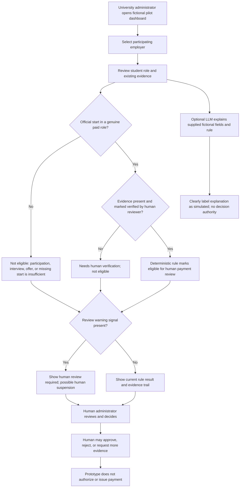
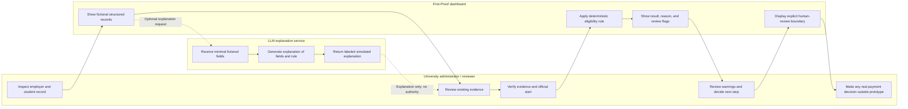

# First-Proof — Money Dashboard

## Project brief

**Role / slice:** Money — a university pilot funding and outcome dashboard.

**Purpose:** Test whether a university will fund First-Proof when employer-partner payment eligibility is tied to a verified hiring-related outcome, rather than participation or interviews. The prototype communicates a proposed funding rule; it does not establish demand, prove outcomes, promise a hire, or set a price.

**Funding principle:** The university is the payer; students pay nothing. Existing evidence comes first. Participation and interviews may be shown as context, but neither makes a payment eligible. A partner employer becomes eligible for university payment consideration only after a student officially starts a genuine paid role. Eligibility is not approval or payment: a human university administrator reviews and authorizes any payment.

**Prototype boundary:** Public, fictional-data-only demonstration. Label every record and dashboard state as fictional. Simulated AI responses must be visibly labeled as simulated/AI-generated; they are explanations, not evidence or decisions.

## Problem

Career-services and employability funding administrators need to evaluate employer partnerships against actual hiring outcomes, but participation and interview counts do not establish that a student started paid work. Without a clear evidence trail and a reviewable rule, administrators cannot readily distinguish a verified start from weaker signals or see when employer behavior warrants scrutiny. First-Proof makes the evidence, deterministic eligibility result, and human-review warnings legible in one dashboard.

## Exact user

**University career-services or employability funding administrator evaluating employer partnerships and actual hiring outcomes.**

The administrator needs to inspect a partner employer, its student outcomes, the evidence and verification status for each claimed start, whether the funding rule makes the record eligible for human payment review, and any warning that calls for additional review.

## Measurable success definition

The prototype succeeds as a decision-support demonstration when a synthetic university administrator can, using only the dashboard:

1. Identify participating employers and the students shown as hired into paid roles.
2. Distinguish a verified official start from participation, an interview, or an unverified claim.
3. Correctly identify which records are eligible for human payment review and explain why.
4. Notice each warning flag and understand that it requires human review, not automatic suspension.
5. Understand that the AI explanation is simulated and cannot verify evidence, decide employability, or authorize payment.

**Acceptance measures:** In moderated synthetic-persona testing, at least 4 of 5 representative task attempts should be completed without facilitator help, and each participant should correctly explain the start-evidence rule and the human approval boundary. Record completion, errors, time, and confusion. If fewer than 4 of 5 attempts succeed, fix the most consequential confusion and repeat the affected task. These are usability targets, not claimed pilot outcomes.

**Outcome learning:** The pilot question is whether the university is willing to consider this outcome-tied model. Capture administrator feedback and, only if a real pilot later has appropriate approvals and evidence, verified paid-start outcomes. Do not represent prototype data or feedback as actual university commitment, hiring, or savings.

## Product behavior and rules

### Dashboard records

Show clearly labeled fictional records for participating employers, participating students, participation/interview context where useful, claimed role, paid status, official start date, evidence reference and verification state, payment eligibility, and warning flags. Use synthetic names and non-identifying evidence references only.

### Deterministic verification and eligibility

- Eligibility requires an employer partnership, a genuine paid role, an official start, and a human-verifiable evidence record whose verification state is `verified`.
- Participation, interview completion, an offer without an official start, missing evidence, or unverified evidence never qualifies.
- Display the rule inputs and a concise reason alongside every eligibility result. Missing or contradictory inputs produce `Needs human verification`, not an eligible result.
- Display eligible records as **Eligible for human payment review — not approved or paid**. The prototype never initiates, schedules, or authorizes a payment.
- The administrator or authorized reviewer is responsible for verifying evidence and making funding decisions. The rule engine applies the stated fields; it does not prove that evidence is authentic.

### Shadow clause and warning flags

Repeated short placements, suspicious employer behavior, or continuing junior work trigger a visible **Human review required** flag and may lead to human-imposed suspension. Warnings do not automatically suspend an employer or change a payment decision.

In the fictional prototype, deterministic flags are driven by explicit synthetic review-signal fields (for example, `repeatedShortPlacements`, `employerBehaviorConcern`, and `juniorWorkContinues`) and show which signal caused the flag. Do not invent a universal numeric threshold or infer misconduct from a pattern. Any real-pilot definitions, thresholds, evidence standards, suspension, or reinstatement rules require university approval and must be documented before use.

### LLM explanation (Dragon Stack)

Provide an optional server-mediated LLM explanation of the selected **fictional** funding record, its structured fields, and the deterministic verification/matching rule. Pass only the minimum synthetic fields needed; ask for a concise explanation of which requirements are met or missing and why the rule returned its result. Label the response **Simulated AI explanation — not verification or a funding decision**. It may summarize supplied data but must not create facts, assess employability, infer a hire, alter records, set eligibility, or authorize payments. If the API is unavailable, show an explicit unavailable state rather than fabricated success; the deterministic dashboard remains usable.

## Mockup reference

Image-generated interface mockup: [Rivermere University Funding Dashboard.png](<./Rivermere University Funding Dashboard.png>). This is visual guidance for the fictional prototype. The implementation should preserve the evidence-first hierarchy: record and evidence status, deterministic eligibility with reason, then review flags and the clearly marked AI explanation.

## User flows

### Funding and outcome flow

### Actor swimlane

## Global benchmark and Mexico-specific difference

**Global benchmark — Northeastern University Co-op:** Use Northeastern’s established co-op model as a benchmark for structured university-employer collaboration and work-integrated learning. First-Proof is not a replacement for co-op, an endorsement by Northeastern, or a claim that co-op participation itself proves a paid hire. The funding experiment is narrower: make actual, verified paid starts the condition for employer-payment eligibility consideration.

**Mexico-specific difference:** Design for a university administrator evaluating local employer partnerships and hiring outcomes in the Mexican context, including locally appropriate evidence and review processes. Do not assume a Northeastern operating model, imported labor-market thresholds, or uniform employer practices apply in Mexico. Validate evidence standards, terminology, and any real funding or labor requirements with the participating Mexican university before a live pilot; the prototype uses fictional records only.

## In three years

First-Proof is a university- and employer-trusted way to review evidence-backed paid starts and decide whether outcome-tied partner funding is worth continuing. Universities use locally approved rules and human review to identify both credible outcomes and employer patterns that warrant scrutiny. Students still pay nothing, and no automated system decides their employability or authorizes funding.

## Scope exclusions

- Real student, employer, university, or hiring data; personally identifiable information; production use.
- Student charges, invented prices, guaranteed hires, promised outcomes, or fabricated evidence.
- Payment processing, disbursement, automatic approval, automatic suspension, or autonomous partner decisions.
- AI-based employability scoring, candidate ranking, evidence verification, or eligibility determination.
- Login, database, persistence, integrations, document uploads, or live verification providers in this public prototype.
- Treating participation, interviews, offers, or unverified starts as payment eligibility.
- Making unapproved policy thresholds or legal/compliance claims for Mexico or any university.
- Presenting fictional data, simulated LLM output, usability-test results, or benchmark descriptions as real results or endorsements.

## Architecture and free-stack

| Layer | Choice | Use and constraints |
|---|---|---|
| Editor | VS Code | Local development, review, and test execution. |
| Application | Next.js | Small dashboard and server route for optional LLM explanations; no database or login. |
| Source control | GitHub | Versioned project and reviewable logical commits. |
| Hosting | Vercel free tier | Public prototype deployments; verify current free-tier limits before deployment. Keep public content strictly fictional. |
| Records | Typed, fictional structured records in source | Seeded synthetic employers, students, role/start fields, evidence status, and review signals; no persistence. |
| Rule engine | Deterministic application logic | Pure, testable eligibility and warning rules; expose inputs and reasons. Human verification and funding approval remain outside automation. |
| Explanation | Free-tier LLM API, such as Gemini API if its free tier and terms are available at implementation | Call only from a Next.js server route. Send minimal fictional fields, constrain response to explanation, and label output simulated. The app must work without the API. |
| Secrets | Local environment variables and Vercel environment settings | Store API key server-side only; never prefix with a public client variable, commit it, or return it to the browser. Provide a safe example environment-variable name without a real value. |
| Validation | Typed schemas / explicit server-side validation | Validate request shape, allowed record identifiers, field lengths, and enum values before rule evaluation or LLM calls. Reject invalid input with a clear error; do not silently fall back. |

**Request path:** Browser dashboard → fictional structured record → deterministic rule evaluation → eligibility/reason and warning flags. Optional explanation request → validated server route → minimal fictional record fields → free-tier LLM API → visibly labeled explanation. The LLM response never flows back into rule inputs or record state.

## Security-floor compliance

- **Data minimization:** Use only obviously fictional, synthetic records and non-identifying evidence references. Never paste real people’s data into the app, tests, prompts, logs, screenshots, or repository.
- **No fake privacy boundary:** No login and no database are acceptable only because the prototype is public and contains fictional data exclusively. Do not add live pilot data without redesigning and approving access control, storage, retention, and privacy requirements.
- **Server-side secrets:** Keep provider keys in server-only environment variables for local development and Vercel. Never put keys in client bundles, source control, URLs, logs, or error messages. Rotate and remove any accidentally exposed key.
- **Input validation:** Validate every request on the server, including record IDs, enum values, and bounded text. Use a fixed record allowlist; do not accept arbitrary prompt text or arbitrary URLs as evidence.
- **LLM boundaries:** Send minimum fictional fields, treat model output as untrusted display text, render safely, handle API errors explicitly, and never let model output change rule results or invoke payment, employment, or administrative actions.
- **Rule integrity:** Keep eligibility deterministic and testable. An unverified or incomplete record cannot become eligible. A warning requests human review and cannot automatically suspend or pay.
- **Deployment hygiene:** Keep fictional-data-only status visible in the interface; inspect preview and production-like deployments for secrets and real data; do not expose debug traces or environment values.
- **Operational limits:** Respect the provider’s current free-tier terms and quotas, avoid sending sensitive data, and show an explicit unavailable state when the service is down or quota-limited.

## Test plan and release gates

1. **Mechanical checks:** Add/run formatting, lint, type-check, and automated tests available in the project. Unit-test eligibility boundaries: verified official paid start is eligible for review; participation, interview, offer-only, missing evidence, unverified evidence, or non-paid role is not. Test each warning signal, combined signals, contradictory/missing inputs, and that a warning never automatically suspends. Test input validation, safe LLM error handling, simulated labeling, and that no LLM output can alter eligibility.
2. **Required defect discovery and fix:** Run the mechanical suite against the implementation and inspect the results until it discovers at least one genuine bug. Record the failing test and observed behavior, fix the root cause, add a regression test, and rerun the relevant suite successfully. Do not manufacture a false failure or count a test setup issue as a product bug.
3. **First deployment:** Deploy a working baseline to Vercel and verify the public URL, fictional-data label, dashboard, deterministic states, and behavior with the LLM key absent. This is deployment 1; no real data or secrets may be exposed.
4. **Synthetic administrator testing:** Test with synthetic university career-services/employability funding-administrator personas. Give participants the five tasks in the measurable success definition without teaching the rule first. Record anonymized task completion, errors, time, exact points of confusion, and misunderstood labels; do not collect real student or employer information.
5. **Confusion fix:** Rank confusion by impact on correct funding interpretation and safety. Fix the single worst issue, then repeat the affected tasks and confirm users distinguish verified start, eligibility for review, human approval, warning flags, and simulated AI explanation.
6. **Redeployment:** Redeploy the corrected build to Vercel and verify the changed flow, regression test behavior, server-only environment configuration, and public fictional-data boundary. This is deployment 2; make at least two distinct Vercel deploys over the project.
7. **Acceptance gate:** No release if a non-qualifying event becomes eligible, an unverified record appears eligible, a warning triggers automatic suspension, model output affects eligibility, the simulated explanation is unlabeled, secrets are client-visible, or any non-fictional personal data is present. Meet the 4-of-5 usability target or document remaining failure and next action without claiming success.

### Five logical commits

1. `docs: define First-Proof funding and evidence rules` — packet and approved decision record.
2. `feat: add fictional structured pilot records` — synthetic data and visible fictional-data boundary.
3. `feat: show deterministic eligibility and review warnings` — rule logic, reasons, and dashboard.
4. `feat: add labeled server-side LLM explanations` — validated route, server-only key, explicit error state.
5. `test: fix discovered defect and prepare pilot demo` — regression and mechanical tests, worst confusion fix, release/deployment verification.

These are planned logical commits, not authorization to commit as part of preparing this packet. Keep each commit coherent; no commit should include secrets or real data.

## Session closeout

- Update `DECISIONS.md` with material decisions, assumptions needing university validation, and any unresolved policy thresholds.
- Record the next concrete action at session close (for example, the first implementation task or the outstanding mockup image handoff).
- Confirm that the final state remains fictional-data-only and that the next action does not imply a verified real-world outcome.
